# Task 1: Multi-container Pods (Init Container & Sidecar)

## Overview

A "hello" page served by nginx on a 3-node minikube cluster. The page shows the current time and refreshes itself every 5 seconds:

```text
hello in MLOPS MENA COMMUNITY : 2026-11-05 18:33:09
```

Each Pod has three containers and **no volumes**:

| Container | Type | Job |
|-----------|------|-----|
| `init-done` | Init container | Prints `done` and exits. The other containers start only after it succeeds. |
| `nginx` | Main container | Writes `index.html` with the time, then serves it on port 80 |
| `time-updater` | Sidecar | Rewrites `index.html` with the new time every 5 seconds |

The sidecar changes a file inside the nginx container without a shared volume:

- `shareProcessNamespace: true` puts all containers of the Pod in one process list, so the sidecar can find the nginx process with `pgrep -o nginx`.
- `/proc/<nginx-pid>/root/` is a view of the nginx container's file system, so the sidecar writes to `/proc/<pid>/root/usr/share/nginx/html/index.html`.
- The capability `SYS_PTRACE` gives the sidecar permission to look inside another container's process.

## Files

| File | Purpose |
|------|---------|
| [`namespace.yaml`](namespace.yaml) | Namespace `webapp` |
| [`deployment.yaml`](deployment.yaml) | Deployment `web-deployment`: 3 replicas, init container, nginx, sidecar |
| [`screenshots/`](screenshots/) | Proof of each step |

## Environment

- Windows 11 + WSL2 (Ubuntu 22.04) + Docker Desktop
- minikube v1.39.0 (Docker driver), kubectl v1.37.2, Kubernetes v1.37.0

---

## Steps

### 1. Create the cluster

1 control-plane + 2 workers, with the Calico network plugin (needed for Task 3):

```bash
minikube start --nodes 3 --cni=calico --cpus 2 --memory 2000
kubectl get nodes
```

The nodes show `NotReady` at first. They become `Ready` once the Calico Pods are running on every node (`kubectl get pods -n kube-system -w`).

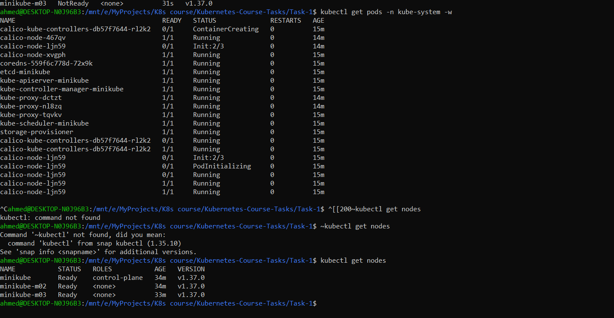

> I used `--memory 2000` instead of `2200`; see [Problems I hit](#problems-i-hit).

### 2. Create the namespace

```bash
kubectl apply -f namespace.yaml
kubectl get namespaces
```

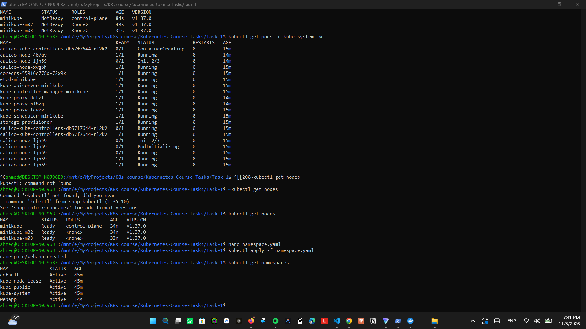

### 3. Write the Deployment

I generated a starting file, then edited it:

```bash
kubectl create deployment web-deployment --image=nginx:1.27 --replicas=3 -n webapp --dry-run=client -o yaml > deployment.yaml
```

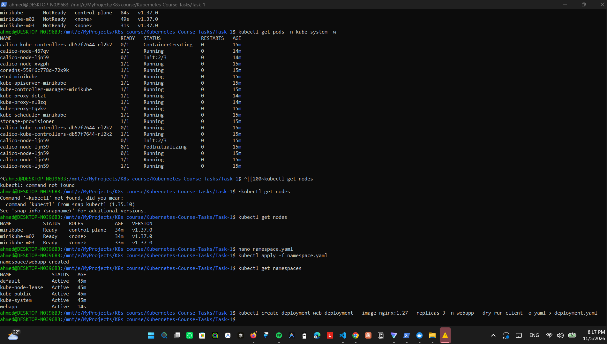

Changes made to the generated file:

1. Label `app: web-deployment` → `app: web` in `selector.matchLabels` **and** `template.metadata.labels` (they must match).
2. Removed the empty generated fields (`strategy: {}`, `resources: {}`, `status: {}`).
3. Added `shareProcessNamespace: true` to the Pod spec.
4. Added the init container `init-done` (`busybox:1.36`, `echo done`).
5. Gave `nginx` port 80 and a command that writes `index.html`, then runs `nginx -g 'daemon off;'`.
6. Added the sidecar `time-updater` (`busybox:1.36`) with the update loop and the `SYS_PTRACE` capability.

The multi-line `|` form is used for the shell commands, so the `"` and `'` quotes inside them need no escaping.

### 4. Deploy and check

```bash
kubectl apply -f deployment.yaml
kubectl get pods -n webapp -w
```

Each Pod goes `Init:0/1` → `PodInitializing` → `2/2 Running`. READY shows `2/2`, not `3/3`, because the init container has finished, so only `nginx` and `time-updater` count.

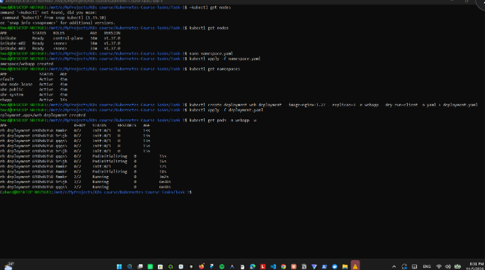

```bash
kubectl port-forward -n webapp deploy/web-deployment 8080:80
```

At <http://localhost:8080>, the time changes after a refresh:

| Before | After refresh |
|--------|---------------|
| 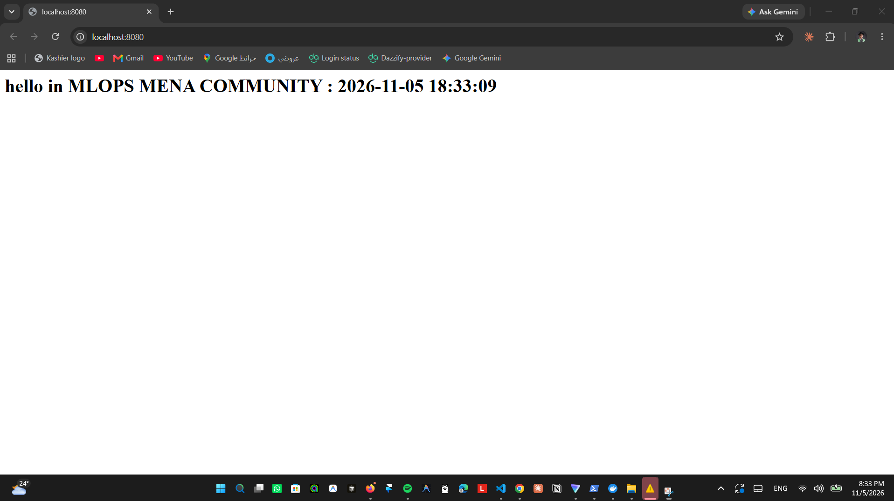 | 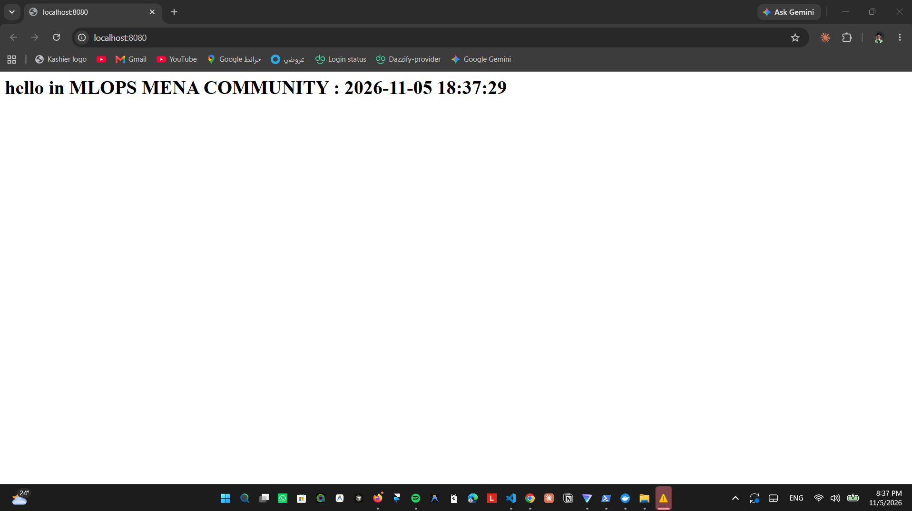 |

> The page time is 2 hours behind my PC clock. That's expected: containers use **UTC**, and my PC is on UTC+2.

### 5. Make the init container fail

I changed only the init container command and applied the file again (without deleting the Deployment):

```yaml
command: ["sh", "-c", "echo 'init failed'; exit 1"]
```

```bash
kubectl apply -f deployment.yaml
kubectl get pods -n webapp -w
```

A new Pod (`web-deployment-7447bb67f7-wxcxb`) loops through `Init:0/1` → `Init:Error` → `Init:CrashLoopBackOff`, with READY `0/2`. The wait between retries grows each time (10s, 20s, 40s, 80s…), which is the "back-off". The 3 old Pods (`698bd6958-...`) stay `2/2 Running`.

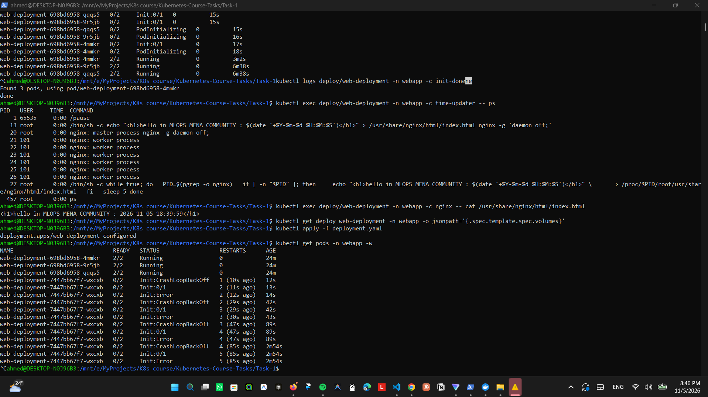

```bash
kubectl logs web-deployment-7447bb67f7-wxcxb -n webapp -c init-done
kubectl describe pod web-deployment-7447bb67f7-wxcxb -n webapp
```

The log shows `init failed`. `describe` shows the init container `Terminated`, `Reason: Error`, `Exit Code: 1`, and a `BackOff` event: `Back-off restarting failed container init-done`.

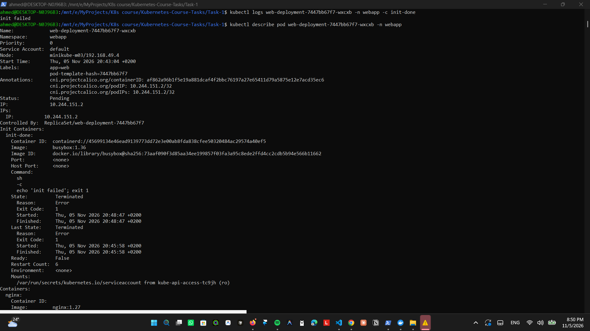

```bash
kubectl rollout status deploy/web-deployment -n webapp
```

The rollout stops at `1 out of 3 new replicas have been updated...`. After 10 minutes (the default `progressDeadlineSeconds: 600`) it reports `exceeded its progress deadline`.

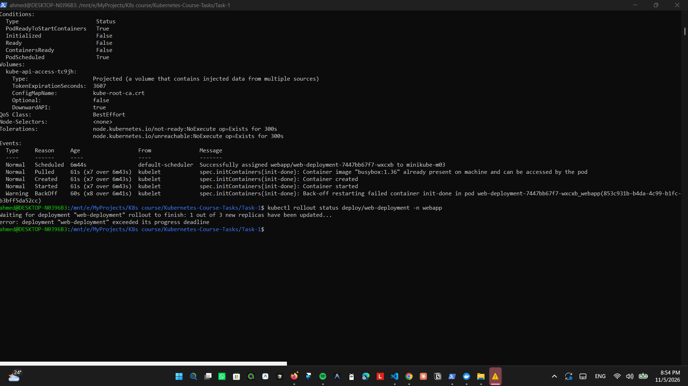

#### Answers

**Which status does the new Pod show?**
`Init:Error` right after each failed run, then `Init:CrashLoopBackOff` while Kubernetes waits before retrying. READY is `0/2`.

**Do `nginx` and `time-updater` start?**
No. Init containers must all exit with code 0 before the main containers start. `init-done` exits with code 1, so `nginx` and `time-updater` are never created in the new Pod.

**Is the page still reachable, and why?**
Yes. The Deployment uses the default **RollingUpdate** strategy: it creates a new Pod first and removes an old Pod only after the new one is ready. The new Pod never becomes ready, so the rollout stops there, and the 3 old Pods keep running and serving the page. Kubernetes does not roll back by itself either: the broken Pod keeps retrying until the Deployment is fixed.

### 6. Fix it

I put back the working init command (`echo done`) and applied again:

```bash
kubectl apply -f deployment.yaml
kubectl rollout status deploy/web-deployment -n webapp
kubectl get deploy web-deployment -n webapp
kubectl get pods -n webapp
```

Result: `successfully rolled out`, READY `3/3`, UP-TO-DATE `3`.

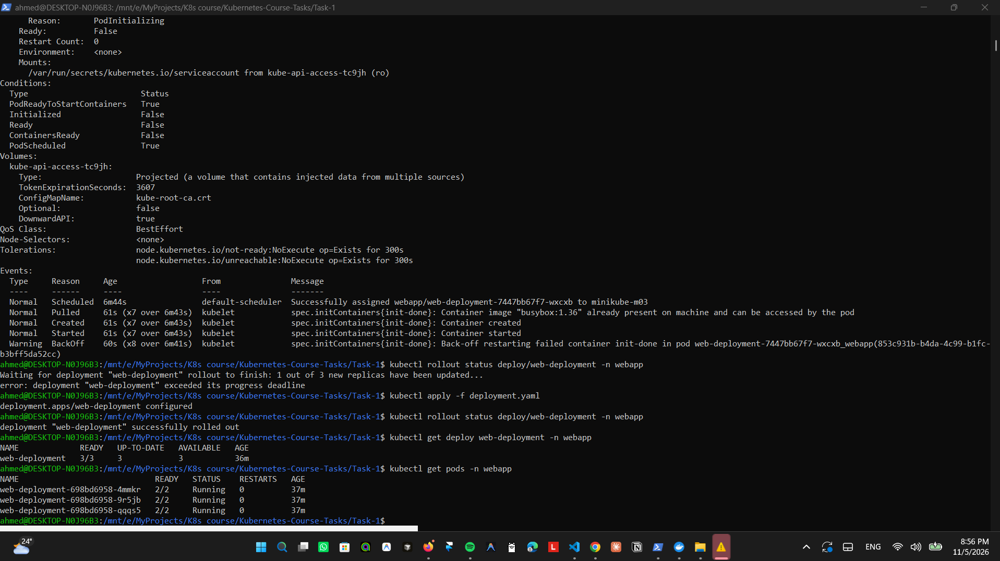

> The fixed Pod template is identical to the original one, so the Deployment reused the original ReplicaSet (`698bd6958`). It deleted the broken Pod and kept the 3 original Pods, which had never stopped running.

---

## Verification

| # | Check | Result |
|---|-------|--------|
| 1 | 3 nodes | `minikube`, `minikube-m02`, `minikube-m03` all `Ready` ✅ |
| 2 | Deployment ready | READY `3/3` ✅ |
| 3 | Pods running | 3 Pods, each `2/2 Running` ✅ |
| 4 | Containers | `init-done nginx time-updater` ✅ |
| 5 | Init succeeded | `kubectl logs ... -c init-done` → `done` ✅ |
| 6 | Sidecar sees nginx | `ps` in `time-updater` shows `nginx: master process` ✅ |
| 7 | Time updates | `cat index.html` in `nginx` shows a new time every 5 s ✅ |
| 8 | No volumes | `jsonpath='{.spec.template.spec.volumes}'` is empty ✅ |
| 9 | Failing init | New Pod `Init:Error` → `Init:CrashLoopBackOff`, `0/2`; old Pods `2/2 Running` ✅ |
| 10 | Init error details | `describe`: `init-done` `Exit Code: 1` ✅ |
| 11 | Fixed | READY `3/3`, UP-TO-DATE `3` ✅ |

Checks 5–8:

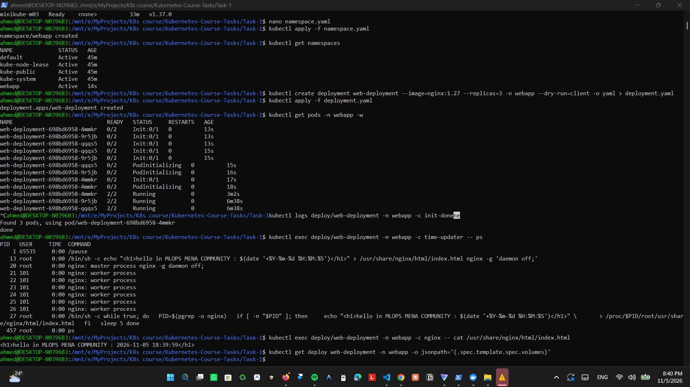

In the `ps` output, PID 1 is `/pause`, the Pod's own small container that holds the shared namespaces. The nginx master and workers and the sidecar loop all appear in the same list, which confirms `shareProcessNamespace` works.

> `describe pod` lists one volume, `kube-api-access-...`. Kubernetes adds it automatically to every Pod for the API token. It is not part of the Deployment spec, which is why check 8 is empty.

---

## Problems I hit

| Problem | Cause | Fix |
|---------|-------|-----|
| `kubectl get nodes` → `localhost:8080 refused` | I ran it in Windows PowerShell; the cluster's kubeconfig is in WSL | Run every command in the Ubuntu (WSL) terminal |
| `docker: command not found` in WSL | Docker Desktop was stopped / WSL integration off | Start Docker Desktop, enable WSL integration for Ubuntu-22.04 |
| Docker Desktop: "WSL distro terminated abruptly" during `minikube start` | Windows ran out of virtual memory (event log: "low virtual memory condition", WSL using ~7.4 GB). The page file was fixed at 8 GB, and other containers were running. | Removed unused containers, set the page file to automatic, limited WSL with `.wslconfig` (`memory=6GB`, `swap=8GB`), used `--memory 2000` per node |
| `kubectl logs <new-pod>` → `No such file or directory` | `<new-pod>` is a placeholder; in bash, `<` means "read from file" | Use the real Pod name |

## What I learned

- An **init container** must succeed before any main container starts. If it fails, the Pod stays in `Init:CrashLoopBackOff` and the app never runs.
- A **sidecar** adds a feature next to the main app without changing it.
- Containers in one Pod can share a process namespace, and `/proc/<pid>/root` gives access to another container's files without a volume.
- A **rolling update** protects the running app: a broken new version never replaces the working Pods.
- A Deployment finds its Pods by **labels**, so `selector.matchLabels` must match the Pod template labels.
