# Task 2: FastAPI + MySQL with ConfigMap, Secret, PV/PVC & Ingress

## Overview

A FastAPI guestbook app backed by one MySQL server, running on the 3-node minikube cluster from Task 1.

```text
Browser → NGINX Ingress Controller → Ingress webapp-ingress → Service webapp-api (80 → 8000) → 2 app Pods
                                                                                                  ↓
                                                  PV mysql-pv (minikube-m02) ← PVC mysql-pvc ← MySQL Pod ← Service mysql (3306)
```

| Concept | Object | Why it is used |
|---------|--------|----------------|
| Namespace | `webapp-stack` | Keeps every object of this task together |
| ConfigMap | `webapp-config` | App settings (title, environment, MySQL address) live outside the image |
| Secret | `mysql-secret` | Passwords are kept apart from normal settings |
| PV + PVC | `mysql-pv` / `mysql-pvc` | MySQL data lives outside the container, so it survives Pod restarts |
| nodeAffinity on the PV | `minikube-m02` | A `hostPath` folder exists on one node only, so MySQL must always run there |
| Ingress | `webapp-ingress` | One entry point from outside, routes `/` to the app Service |

The app (`webapp/`) and the MySQL image (`mysql/`) are provided by the course. I built them without changes.

## Files

| File | Purpose |
|------|---------|
| [`namespace.yaml`](namespace.yaml) | Namespace `webapp-stack` |
| [`secret.yaml`](secret.yaml) | Secret `mysql-secret`: `root-password`, `app-user`, `app-password` |
| [`configmap.yaml`](configmap.yaml) | ConfigMap `webapp-config`: `APP_TITLE`, `APP_ENV`, `MYSQL_HOST`, `MYSQL_PORT`, `MYSQL_DATABASE` |
| [`pv-pvc.yaml`](pv-pvc.yaml) | PV `mysql-pv` (2Gi, hostPath, pinned to `minikube-m02`) + PVC `mysql-pvc` |
| [`mysql.yaml`](mysql.yaml) | Deployment `mysql` (1 replica, `Recreate`) + ClusterIP Service `mysql` on 3306 |
| [`webapp.yaml`](webapp.yaml) | Deployment `webapp-api` (2 replicas) + ClusterIP Service `webapp-api` 80 → 8000 |
| [`ingress.yaml`](ingress.yaml) | Ingress `webapp-ingress`, class `nginx`, path `/` → `webapp-api:80` |
| [`webapp/`](webapp/) | Provided FastAPI app + Dockerfile |
| [`mysql/`](mysql/) | Provided MySQL 8.4 image: config, init script, schema |
| [`screenshots/`](screenshots/) | Proof of each step |

## Environment

- Windows 11 + WSL2 (Ubuntu 22.04) + Docker Desktop
- minikube v1.39.0 (Docker driver, 3 nodes, Calico), Kubernetes v1.37.0

---

## Steps

### 1. Start the cluster

```bash
minikube start
kubectl get nodes
```

All 3 nodes `Ready`. The `StartHost failed, but will try again` message is harmless: Docker Desktop was still starting, and the retry worked.

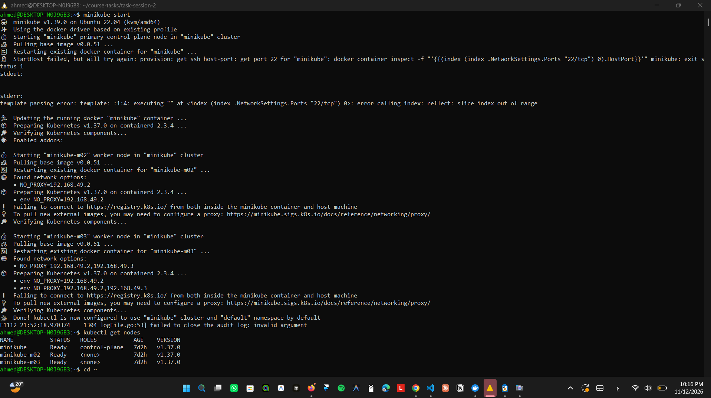

### 2. Build the images and load them into minikube

I cloned the course repo **inside WSL** (not on the Windows drive) so the shell script keeps Linux line endings, copied `webapp/` and `mysql/` into this folder, and built from the WSL copy:

```bash
git clone https://github.com/MLOpsMENACommunity/Kubernetes-Course-Tasks.git course-tasks
cd ~/course-tasks/task-session-2
chmod -x mysql/initdb/01-setup.sh
docker build -t webapp-api:task2 ./webapp
docker build -t webapp-mysql:task2 ./mysql
minikube image load webapp-api:task2
minikube image load webapp-mysql:task2
minikube image ls | grep task2
```

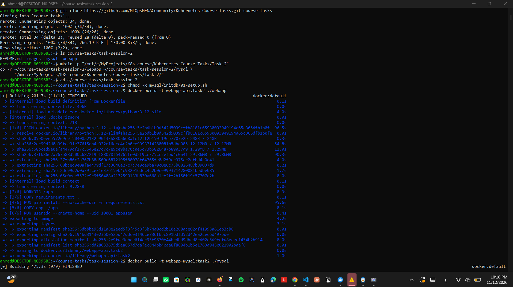

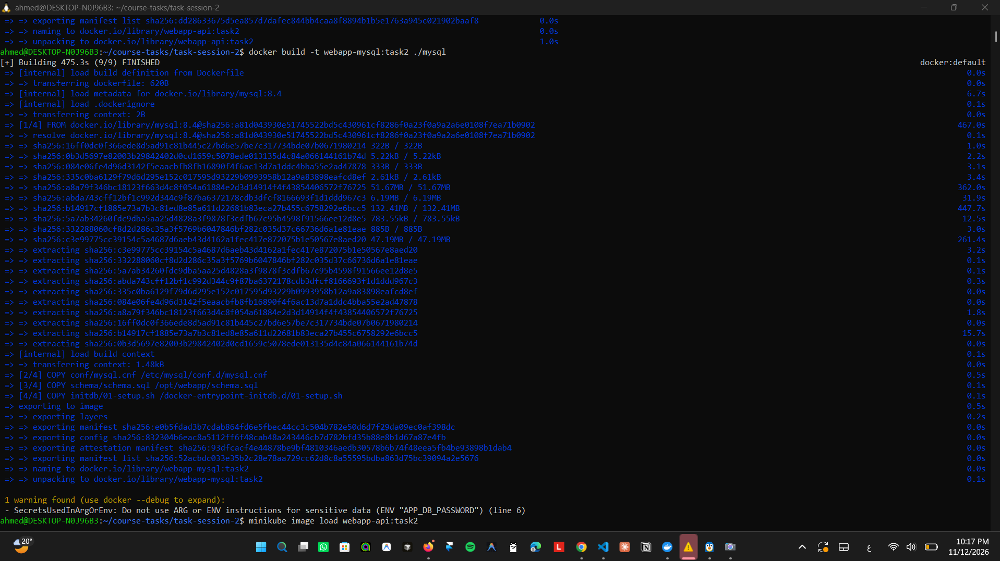


**Why `chmod -x`?** The MySQL entrypoint *runs* executable `.sh` files in `/docker-entrypoint-initdb.d/` in a new shell, but *sources* non-executable ones in its own shell. `01-setup.sh` uses the entrypoint's functions `mysql_note` and `docker_process_sql`, which exist only when the file is sourced.

**Why `minikube image load`?** The cluster nodes have their own container runtime and can't see images on my Docker host. The Deployments use `imagePullPolicy: IfNotPresent`, so they use the loaded image instead of trying to pull it.

> The build warning `SecretsUsedInArgOrEnv` is about the default password in the MySQL Dockerfile. In Kubernetes the real values come from `mysql-secret` and override it.

### 3. Namespace, Secret and ConfigMap

```bash
kubectl apply -f namespace.yaml
kubectl apply -f secret.yaml
kubectl apply -f configmap.yaml
kubectl get secret mysql-secret -n webapp-stack
kubectl get configmap webapp-config -n webapp-stack
```

Secret `DATA 3`, ConfigMap `DATA 5`.

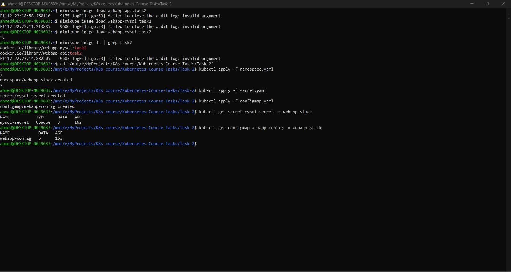

- The Secret uses `stringData`, so I write plain text and Kubernetes stores it base64-encoded. Base64 is only an encoding, not encryption.
- `MYSQL_PORT` is written as `"3306"`: ConfigMap values must be strings.

### 4. PV and PVC

```bash
kubectl apply -f pv-pvc.yaml
kubectl get pv mysql-pv
kubectl get pvc mysql-pvc -n webapp-stack
```

Both `Bound`, `2Gi`, class `manual`, claim `webapp-stack/mysql-pvc`.

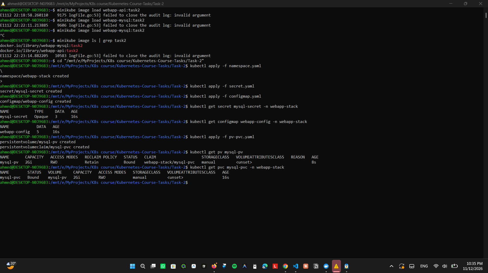

- The PV has **no namespace** (cluster-wide); the PVC is in `webapp-stack`.
- `storageClassName: manual` on both: a PVC binds only to a PV with the same class. Without it, minikube's default class `standard` would create a different volume.
- `persistentVolumeReclaimPolicy: Retain` keeps the data if the PVC is deleted.
- `nodeAffinity` → `minikube-m02`: the `hostPath` folder `/data/webapp-mysql` exists on that node only. Without it, MySQL could restart on another node, get an empty folder, and the data would look lost.

### 5. MySQL Deployment and Service

```bash
kubectl apply -f mysql.yaml
kubectl get pods -n webapp-stack -o wide -w
kubectl logs deploy/mysql -n webapp-stack | grep -i "ready for connections"
kubectl exec -n webapp-stack deploy/mysql -- sh -c 'mysql -uroot -p"$MYSQL_ROOT_PASSWORD" -e "SELECT * FROM webapp.messages"'
```

The Pod is `1/1 Running` on **minikube-m02** (because of the PV's nodeAffinity), and the table has the 2 default messages.

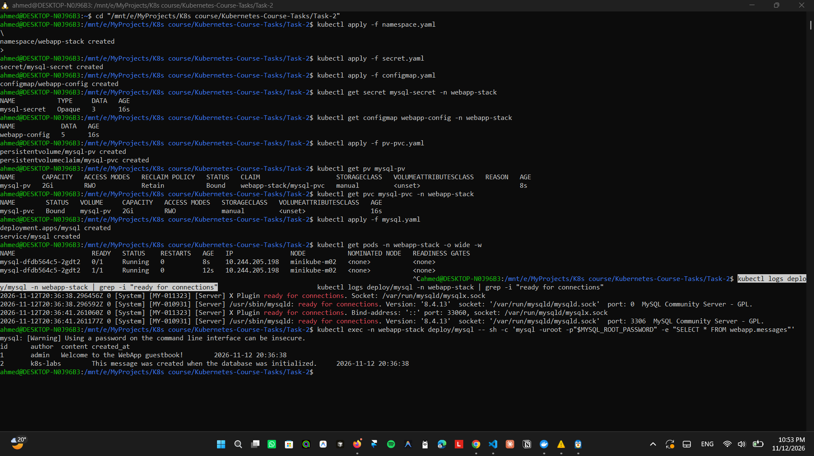

- `strategy: Recreate`: the old Pod stops before the new one starts, so two MySQL servers never use the same data folder.
- Passwords come from the Secret (`secretKeyRef`). The database name comes from the ConfigMap (`configMapKeyRef`, key `MYSQL_DATABASE` → variable `APP_DB_NAME`).
- The PVC is mounted at `/var/lib/mysql`.
- Readiness and liveness probes run `mysqladmin ping -h 127.0.0.1`. The liveness probe waits 60 s, because the first start creates the database.
- `ready for connections` appears twice: first a temporary server on `port: 0` that runs the init script, then the real server on `port: 3306`.

### 6. App Deployment and Service

```bash
kubectl apply -f webapp.yaml
kubectl get pods -n webapp-stack -o wide
kubectl get deploy -n webapp-stack
kubectl exec -n webapp-stack deploy/webapp-api -- env | grep -E "APP_|MYSQL_"
kubectl get endpoints webapp-api -n webapp-stack
```

`mysql 1/1`, `webapp-api 2/2`, the variables are set, and the Service has 2 endpoints on port 8000. The 2 app Pods run on different nodes (`m02` and `m03`).

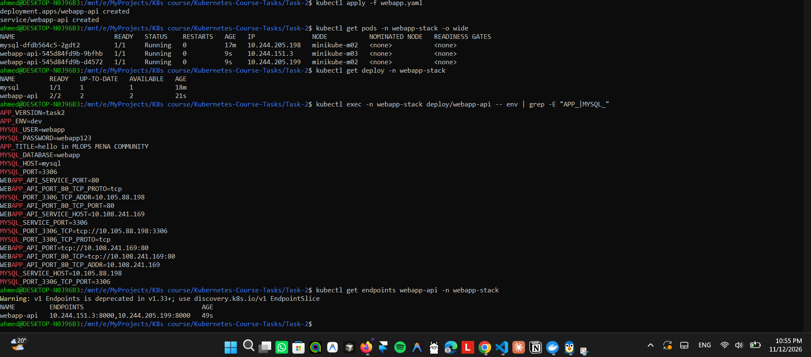

- `envFrom` + `configMapRef` loads all 5 ConfigMap keys at once; `MYSQL_USER` and `MYSQL_PASSWORD` come from the Secret. The app never gets the root password.
- `MYSQL_HOST=mysql` works because a Service name is a DNS name inside the namespace.
- Kubernetes also adds variables for every Service (`MYSQL_PORT_3306_TCP=...`, `MYSQL_SERVICE_HOST=...`). One of them would be `MYSQL_PORT=tcp://10.105.88.198:3306`, which the app can't use. The ConfigMap value `MYSQL_PORT=3306` replaces it.
- Probes: `GET /health` on port 8000.

### 7. Install the NGINX Ingress Controller

```bash
minikube addons enable ingress
kubectl get pods -n ingress-nginx -w
kubectl get ingressclass
```

`minikube addons enable ingress` exited with `context deadline exceeded`:

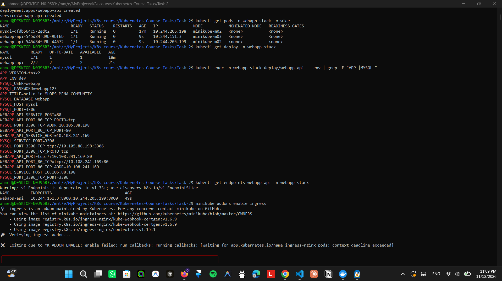

That was only a timeout. Downloading the controller image from `registry.k8s.io` took **5 min 37 s** on my connection, longer than minikube waits. The controller then started by itself: `1/1 Running`, and the IngressClass `nginx` exists. The `admission-*` Pods are one-time jobs, so `Completed` is expected.

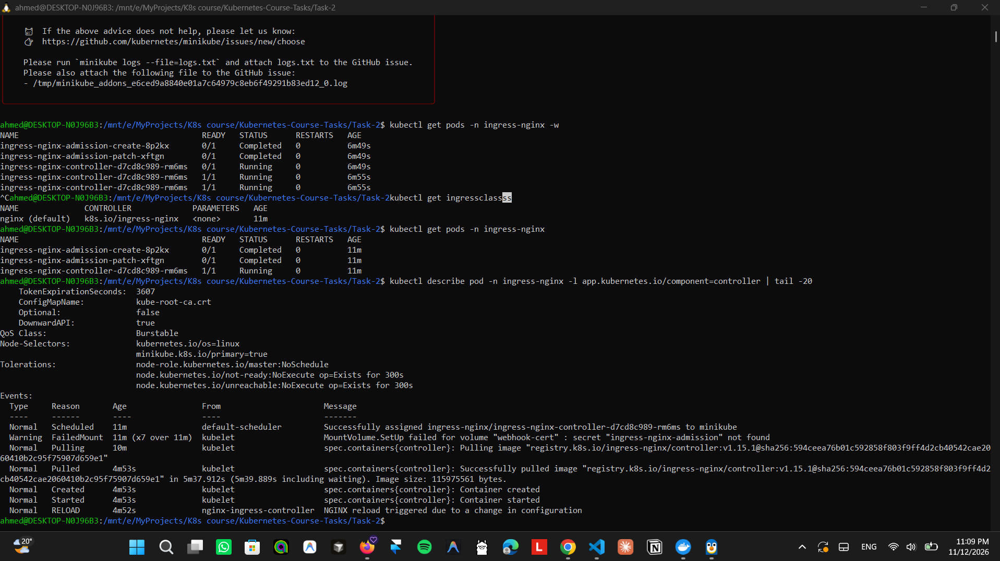

> The early `FailedMount ... secret "ingress-nginx-admission" not found` event is normal: the controller waits until the `admission-create` job creates that secret.

### 8. Create the Ingress

```bash
kubectl apply -f ingress.yaml
kubectl get ingress -n webapp-stack
```

Class `nginx`. ADDRESS is empty for the first seconds, then becomes `192.168.49.2`.

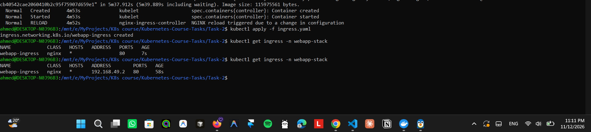

### 9. Open the app through the Ingress

Terminal 1 (keeps running):

```bash
kubectl port-forward -n ingress-nginx svc/ingress-nginx-controller 8080:80
```

Terminal 2:

```bash
curl http://localhost:8080/api/info
curl -X POST http://localhost:8080/api/messages -H "Content-Type: application/json" -d '{"author":"Ahmed","content":"hello from Task 2"}'
curl http://localhost:8080/api/messages
```

- `/api/info` → `"version":"task2"`, `"title":"hello in MLOPS MENA COMMUNITY"`, `"environment":"dev"`, `"db_host":"mysql"`
- POST → `{"id":3,"written_to":"mysql-dfdb564c5-2gdt2"}`
- `/api/messages` → my message + the 2 default ones

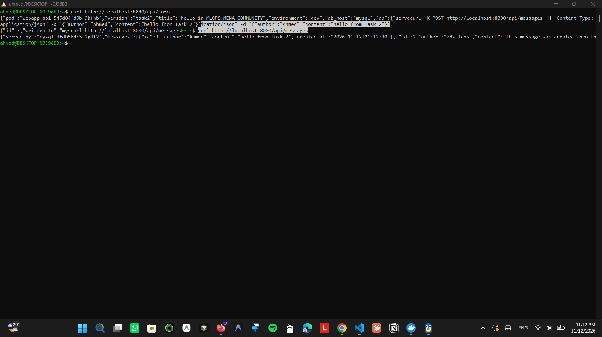

> The JSON has no newline at the end, so the next prompt prints on the same line. `curl -s ... | python3 -m json.tool` gives cleaner output.

In the browser at <http://localhost:8080>: the title from the ConfigMap, the app Pod and MySQL server that answered, and the guestbook. I added a second message (`HIII`) from the page.

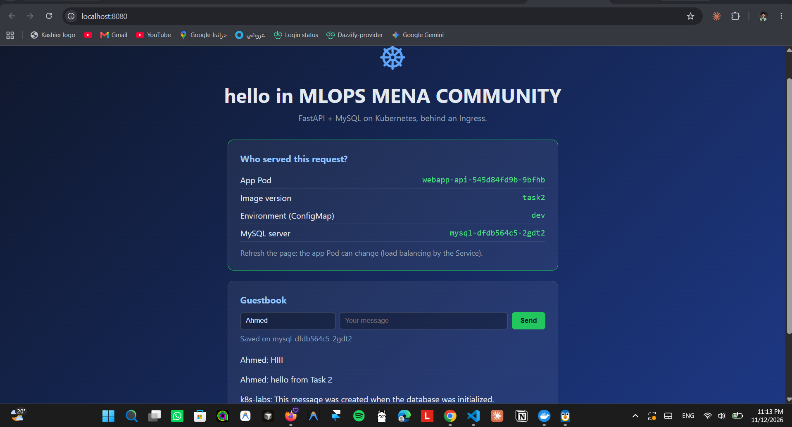

### 10. Data survives a MySQL Pod restart

```bash
kubectl get pods -n webapp-stack -l app=mysql -o wide
kubectl delete pod -n webapp-stack -l app=mysql
kubectl get pods -n webapp-stack -l app=mysql -o wide -w
curl -s http://localhost:8080/api/messages | python3 -m json.tool
```

| | Before | After |
|---|---|---|
| MySQL Pod | `mysql-dfdb564c5-2gdt2` | `mysql-dfdb564c5-2lkc5` (new) |
| Node | `minikube-m02` | `minikube-m02` |
| Messages | 4 | 4, served by the new Pod |

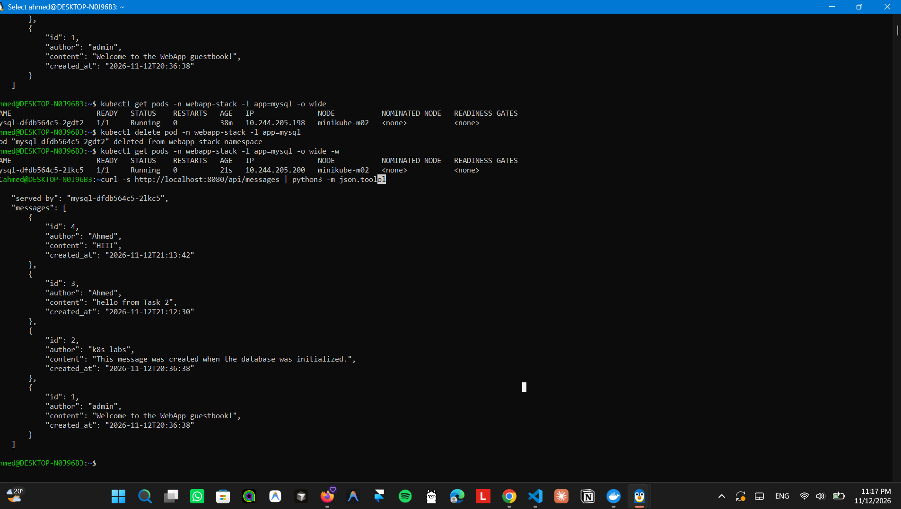

The container was deleted, but the data is in `/data/webapp-mysql` on `minikube-m02`. The Deployment created a new Pod, nodeAffinity put it on the same node, and it mounted the same folder through the PVC. The data folder was not empty, so the init script did not run again and all messages were still there.

---

## Verification

| # | Check | Result |
|---|-------|--------|
| 1 | Images loaded | `webapp-api:task2`, `webapp-mysql:task2` ✅ |
| 2 | Secret and ConfigMap | DATA `3` and `5` ✅ |
| 3 | PV and PVC | `Bound`, `2Gi`, class `manual` ✅ |
| 4 | Deployments | `mysql 1/1`, `webapp-api 2/2` ✅ |
| 5 | MySQL on the PV node | `1/1 Running` on `minikube-m02` ✅ |
| 6 | App env | `APP_TITLE`, `MYSQL_HOST=mysql`, `MYSQL_PORT=3306`, `MYSQL_USER`, `MYSQL_PASSWORD` ✅ |
| 7 | Default data | 2 default messages ✅ |
| 8 | Ingress | Class `nginx`, ADDRESS `192.168.49.2` ✅ |
| 9 | `/api/info` | `version task2`, title from ConfigMap, `environment dev`, `db` = MySQL Pod ✅ |
| 10 | Write a message | `{"id":3,"written_to":"mysql-..."}` ✅ |
| 11 | Read messages | My messages + the 2 default ones ✅ |
| 12 | Data survives a restart | New MySQL Pod, same node, all messages still there ✅ |

---

## Problems I hit

| Problem | Cause | Fix |
|---------|-------|-----|
| `minikube start` → `PROVIDER_DOCKER_VERSION_EXIT_1`, and `kubectl` → `localhost:8080 refused` | Docker Desktop was not running / WSL integration was off, so minikube could not start the node containers | Started Docker Desktop, enabled WSL integration for Ubuntu-22.04, opened a new terminal |
| Risk of a broken init script | My Windows git has `core.autocrlf=true`, which can turn `01-setup.sh` into CRLF line endings that bash inside the container can't run | Cloned and built inside WSL, and added [`.gitattributes`](.gitattributes) to keep LF line endings in the repo |
| Slow image downloads (`mysql:8.4` took ~8 min) | Slow network | Waited; later builds use the cache |
| `minikube addons enable ingress` → `context deadline exceeded` | The controller image needed 5 min 37 s to download, longer than minikube waits | Nothing: the controller started by itself. Checked with `kubectl get pods -n ingress-nginx` |
| `failed to close the audit log: invalid argument` after minikube commands | minikube logging bug on WSL | Harmless, ignored |

## What I learned

- A **ConfigMap** holds normal settings and a **Secret** holds passwords. Both are injected as environment variables, so the same image runs anywhere.
- `envFrom` loads a whole ConfigMap; `secretKeyRef` / `configMapKeyRef` load one key and can rename it.
- A **PVC** asks for storage, a **PV** provides it. They bind when the size, access mode and `storageClassName` match.
- A `hostPath` PV lives on one node, so **nodeAffinity** is needed to keep the Pod next to its data.
- `strategy: Recreate` prevents two database servers from writing to the same data folder.
- A **Service name is a DNS name**, so the app reaches MySQL at `mysql:3306`.
- An **Ingress** is only a set of rules; an **Ingress Controller** (NGINX) is needed to make them work.
- Deleting a Pod deletes the container, not the data on the PV.
